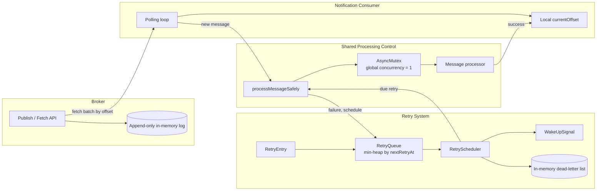
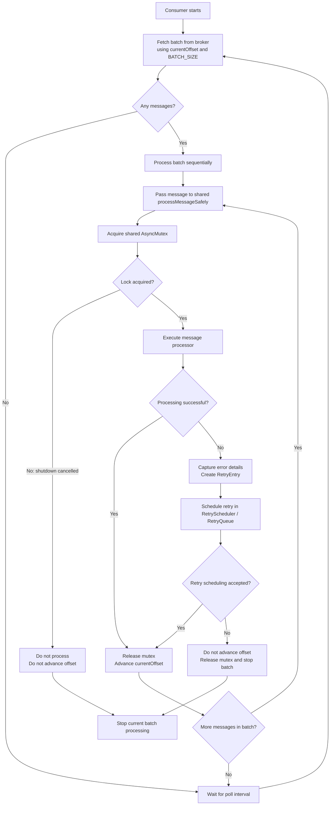
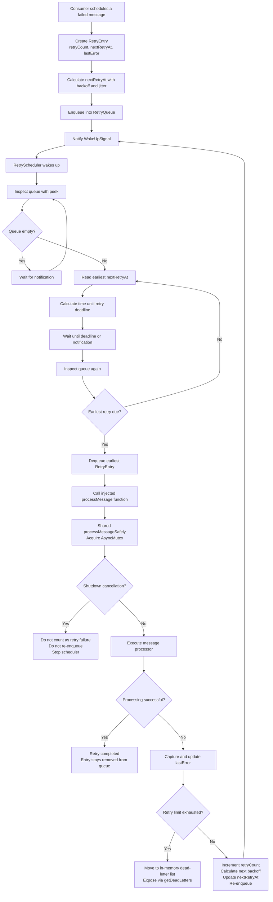
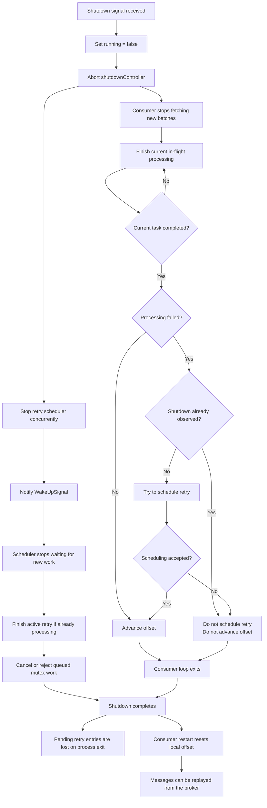
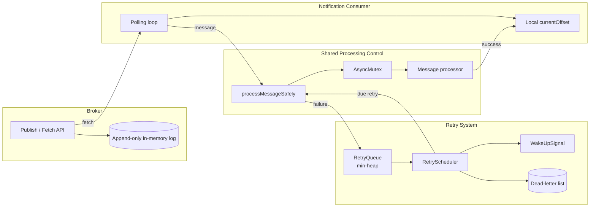

# Ley V0.2 — Consumer Failure Handling and Retry Architecture

> Scope: V0.2 adds a long-running consumer, retry scheduling, exponential backoff,
> dead-letter handling, graceful shutdown, and explicit ordering rules for concurrent
> publishing. This document reflects the V0.2 source tree at the time of writing.

## 1. Goals and non-goals

### Goals

- Let a consumer keep polling the broker instead of processing a single batch.
- Serialize all message processing through one shared mutex.
- Retry failed messages without blocking new message processing.
- Use deadline-based retry scheduling with exponential backoff and jitter.
- Stop retrying after a bounded number of attempts and preserve exhausted messages for inspection.
- Shut down gracefully: stop new work, finish in-flight work, and cancel queued work.
- Define exactly what ordering the broker does and does not guarantee under concurrent publishing.

### Non-goals

- Durable offsets, retry queues, or dead-letter queues.
- Exactly-once processing.
- Consumer groups, partition assignment, leases, or broker-managed ownership.
- Cross-process ordering or multi-node coordination.

## 2. System overview



The architecture in one sentence:

**The broker stores messages, the consumer manages progress, the retry system manages
failed work, and the shared mutex controls access to message processing.**

## 3. Complete consumer processing flow



### Step-by-step responsibilities

| Step | Responsible component | Behaviour |
| --- | --- | --- |
| Fetch a batch | `examples/consumer/notification-service/index.ts` + `examples/consumer/shared/broker-client.ts` | Requests `offset = currentOffset` and `limit = BATCH_SIZE` from the broker. An `AbortSignal` cancels an in-flight fetch during shutdown. |
| Track progress | `examples/consumer/notification-service/offset/offset-manager.ts` | Owns the local `currentOffset`. There is no broker-side consumer offset. |
| Serialize processing | `examples/consumer/shared/async-mutex.ts` | Allows exactly one task at a time. Accepts an `AbortSignal` so a task still waiting for the lock can be cancelled during shutdown. |
| Join both paths | `examples/consumer/notification-service/index.ts` | Creates one `processMessageSafely` function and gives it to both the polling loop and the retry scheduler. |
| Execute a message | `examples/consumer/notification-service/processing/message-processor.ts` | Performs the domain work. In V0.2 it simulates delivery with a delay and a configurable failure rate. |
| Advance progress | `notification-service/index.ts` | Advances the offset only after successful processing, or after a failed message was successfully scheduled for retry. |
| Build retry state | `notification-service/retry/retry-entry.ts` | Stores `message`, `retryCount`, `nextRetryAt`, and structured `lastError` data. |
| Schedule a retry | `notification-service/retry/retry-scheduler.ts` | Enqueues the entry and notifies the scheduler. Refuses new entries once the scheduler is stopped. |

**Important:** a failed message does not block later messages. Once its retry has been
successfully scheduled, the consumer advances its offset and continues with the next
message. The retry scheduler handles the failed message independently.

## 4. Detailed retry processing flow

Three components make up the retry system:

1. `RetryQueue` stores entries in deadline order.
2. `WakeUpSignal` wakes the scheduler when the queue changes or when a deadline expires.
3. `RetryScheduler` decides when a retry is due and executes it.



The scheduler does not know about the mutex. It only calls the injected processing
function. The shared processing function owns concurrency control. That separation is
intentional and is explained in section 8.

## 5. Retry timing and retry-count flow

The retry policy uses exponential backoff with jitter:

```
delay      = min(BASE_RETRY_DELAY_MS * BACKOFF_MULTIPLIER^retryCount, MAX_RETRY_DELAY_MS)
minDelay   = delay * (1 - JITTER_FACTOR)
maxDelay   = delay * (1 + JITTER_FACTOR)
randomized = minDelay + random() * (maxDelay - minDelay)
final      = min(randomized, MAX_RETRY_DELAY_MS)
```

Jitter prevents many failed messages from retrying at exactly the same time
(the thundering-herd problem).

### Configuration

| Setting | Value |
| --- | --- |
| Batch size | 10 messages |
| Poll interval | 1,000 ms |
| Base retry delay | 2,000 ms |
| Maximum retry delay | 20,000 ms |
| Backoff multiplier | 2 |
| Jitter factor | 0.3 (30%) |
| Maximum retries | 5 |
| Total attempts including the initial attempt | 6 |

### Attempts versus retries

| Attempt | What happens | Retry count after failure |
| --- | --- | --- |
| 1 | Initial processing fails | 0 |
| 2 | First retry fails | 1 |
| 3 | Second retry fails | 2 |
| 4 | Third retry fails | 3 |
| 5 | Fourth retry fails | 4 |
| 6 | Fifth retry fails | 5, exhausted |

`MAX_RETRIES = 5` means five retries **after** the initial attempt. A successful attempt
at any point ends the retry process.

### Approximate delay schedule

With jitter disabled for illustration:

| Retry | Backoff before jitter | After the 20 s cap |
| --- | --- | --- |
| 1 | 2,000 ms | 2,000 ms |
| 2 | 4,000 ms | 4,000 ms |
| 3 | 8,000 ms | 8,000 ms |
| 4 | 16,000 ms | 16,000 ms |
| 5 | 32,000 ms | 20,000 ms |

Jitter is applied around the capped delay, and the result is clamped again so it never
exceeds the maximum.

## 6. Component and file responsibilities

| File | Responsibility |
| --- | --- |
| `examples/consumer/notification-service/index.ts` | Application entry point. Creates shared dependencies, starts the polling loop and scheduler, owns shutdown coordination. |
| `examples/consumer/notification-service/config.ts` | Batch size, poll interval, retry limits, backoff, and jitter configuration. |
| `examples/consumer/notification-service/offset/offset-manager.ts` | In-memory `currentOffset` and `advance()`. |
| `examples/consumer/notification-service/processing/message-processor.ts` | Simulated domain processing with configurable delay, failure rate, and random source. |
| `examples/consumer/notification-service/retry/retry-entry.ts` | `RetryEntry` shape: message, retry count, deadline, last error. |
| `examples/consumer/notification-service/retry/retry-queue.ts` | Wraps the generic priority queue and orders entries by `nextRetryAt`. |
| `examples/consumer/notification-service/retry/retry-delay.ts` | Exponential backoff, jitter, capping, and input validation. |
| `examples/consumer/notification-service/retry/retry-scheduler.ts` | Retry loop, deadline waiting, execution, rescheduling, dead-letter handling, and shutdown. |
| `examples/consumer/shared/async-mutex.ts` | Exclusive processing and cancellation of tasks still waiting for the lock. |
| `examples/consumer/shared/min-heap.ts` | Generic binary min-heap with `push`, `pop`, `peek`, and `isEmpty`. |
| `examples/consumer/shared/wake-up_signal.ts` | Notification-based waking with timeout support; retains a notification that arrives before a wait. |
| `examples/consumer/shared/broker-client.ts` | HTTP fetch of a message batch from the broker with an abort signal. |
| `examples/consumer/shared/shutdown.ts` | Installs `SIGINT` / `SIGTERM` handlers, runs all stop functions, and forces exit after a timeout. |
| `src/broker/modules/storage/memory-log.ts` | Append-only in-memory log. Offset assignment and insertion stay in one synchronous block. |
| `src/broker/modules/broker/broker.service.ts` | Validates messages, publishes with the returned offset, and fetches batches. |

## 7. Tests and verification

| File | What it verifies |
| --- | --- |
| `tests/unit/consumer-components.test.ts` | Mutex sequencing, failure isolation, original error propagation, mutex cancellation, priority queue ordering, retry queue ordering, wake-up signal timing, backoff/jitter/cap, retry scheduler deadline/retry/exhaustion/shutdown, and the 60/40 processor simulation. |
| `tests/integration/consumer.test.ts` | Multiple producers and consumers, retry scheduling, retry success, retry rescheduling, processing serialization, continued processing after failure, graceful shutdown during normal and retry processing, mutex-queued cancellation, and volatile restart behavior. |
| `tests/integration/concurrency.test.ts` | Concurrent publishing, unique and continuous offsets, stable total order across reads, append order versus creation time, prefix-only reads during publishing, and per-key ordering as a projection of append order. |
| `tests/integration/messages.test.ts` | HTTP contract, validation, offset fetching, and restart behavior. |
| `tests/unit/broker.test.ts` | Schema, memory storage, broker service, and query validation. |

As of this document, the suite contains **105 passing tests** and `tsc --noEmit` is clean.
Timing-sensitive suites were repeated: the consumer integration suite passed 15/15 runs,
and the concurrency/ordering suite passed 20/20 runs.

## 8. Why we designed it this way

| Decision | Why |
| --- | --- |
| Consumer-managed retries | Keeps retry responsibility outside the broker. The broker remains a simple append-only log. |
| Separate retry scheduler | A failed message's backoff delay must not block normal message polling. |
| Min-heap priority queue | We need to find the retry with the earliest deadline efficiently. |
| Absolute `nextRetryAt` | Allows sleeping until a specific deadline instead of polling every entry. |
| Wake-up signal | Avoids busy-polling the retry queue when there is no work. |
| Exponential backoff | Gives a failing downstream dependency time to recover. |
| Jitter | Prevents synchronized retries from producing another traffic spike. |
| Shared async mutex | Enforces the chosen global processing concurrency of one. |
| Injected processing function | Keeps the scheduler independent of the mutex and application logic. |
| Structured error data | Preserves useful error information without serializing raw `Error` objects. |
| In-memory dead-letter list | Makes exhausted messages inspectable without adding persistence in V0.2. |
| Cancel queued mutex tasks | Prevents waiting work from starting during shutdown. |
| Finish in-flight work | Avoids interrupting a message halfway through processing. |
| Stop scheduler concurrently with the consumer drain | Prevents a retry queued behind the mutex from being counted as a failed attempt during shutdown. |

### Why not a normal FIFO queue for retries?

A FIFO queue processes retries in insertion order. Consider:

- Message A should retry in 20 seconds.
- Message B should retry in 3 seconds.
- Message C should retry in 8 seconds.

FIFO would make B wait behind A. A min-heap yields B, then C, then A, which is the
correct deadline order.

### Why the scheduler does not own the mutex

We wanted one place to control processing concurrency. If the consumer and the retry
scheduler each had a mutex, a new message and a due retry could process at the same
time. Instead, `index.ts` creates one mutex and exposes one shared processing function
to both paths. Both normal processing and retry processing obey the same rule.

## 9. Graceful shutdown flow



### Shutdown policy

- Stop fetching new batches.
- Finish the current in-flight message.
- Do not start the remaining messages from the fetched batch.
- Stop the retry scheduler concurrently with the consumer drain.
- Finish an active retry.
- Cancel work that is still waiting inside the mutex.
- Do not count shutdown-cancelled work as a failed retry attempt.
- Do not advance the offset when processing was cancelled before completion.
- Pending retry entries are lost when the process exits.
- Restarting the consumer resets the local offset, so messages can be replayed.

### Subtlety

If a failed message was successfully added to the retry queue before shutdown, its
offset may already have advanced. The retry entry itself is in memory and is lost on
exit. On restart the local offset is `0`, so the broker can replay the message. This
can produce duplicate processing, which is why downstream side effects need idempotency.

## 10. Message ordering under concurrency

The broker defines one total order over accepted messages: **append order**, the order
in which `append` runs. Offset `n` was appended before offset `n + 1`.

- **Atomic offset assignment.** `append` reads the current length, pushes the message,
  and returns the offset in one synchronous block. Node runs that block to completion
  before another request handler can run, so concurrent publishes cannot interleave
  inside it. Every accepted message gets a unique, gap-free offset.
- **Append order is not timestamp order.** `timestamp.created_at` is producer metadata
  and is never used to assign offsets. The total order is the order in which
  fully-parsed publish handlers reach the broker, not socket arrival order, HTTP send
  order, or event creation time.
- **Rejected messages consume no offset.** Validation fails before `append`, so a
  rejected publish does not create gaps in the accepted sequence.
- **Stable reads.** The log is append-only. A reader that fetches while publishes are in
  flight sees a prefix of the final log, never a partial or reordered message.
- **Consumers share the total order.** Every consumer reads by increasing offset and
  processes batches sequentially. Per-key ordering is only the projection of the total
  order; there is no stronger per-key guarantee and no use of creation time or
  causality. Producers that need causal per-key order must serialize those publishes.

This guarantee depends on the publish path staying synchronous. If persistence,
network I/O, or any `await` is added between reading the offset and appending, offset
assignment must be protected by a mutex or queue. The guarantee also does not extend
across processes.

## 11. Guarantees and limitations

| Area | V0.2 behaviour |
| --- | --- |
| Message storage | In-memory broker log |
| Consumer offset | In-memory |
| Retry queue | In-memory |
| Dead-letter storage | In-memory |
| Retry timing | Exponential backoff with jitter |
| Processing concurrency | One globally, enforced by the shared mutex |
| Retry ordering | Earliest retry deadline first |
| Failed message handling | Scheduled for retry |
| Exhausted messages | Moved to an in-memory dead-letter list |
| Graceful shutdown | Stops new work, cancels queued work, finishes active work |
| Process crash recovery | Messages may replay from the beginning |
| Duplicate processing | Possible |
| Durable delivery guarantee | Not provided |
| Exactly-once processing | Not provided |
| Automatic consumer failure detection | Not provided |

**Important limitation:** retry handling does not guarantee exactly-once processing. If
a message's side effect succeeds but the consumer crashes before recording progress,
the message can be processed again after restart. Real downstream operations need
idempotency protection.

## 12. What we deliberately left out

These are future coordination or durability features, not accidental omissions:

- Leases.
- Heartbeats and heartbeat timeouts.
- Fencing tokens.
- Consumer groups.
- Partition assignment.
- Durable consumer offsets.
- Persistent retry queues.
- Persistent dead-letter queues.
- Broker persistence and replication.
- Exactly-once processing guarantees.

Leases, heartbeats, and fencing tokens become relevant when we introduce coordinated
ownership and takeover between consumers. The current single-consumer design does not
need them.

## 13. Complete mental model



The architecture can be summarized in one sentence:

**The broker stores messages, the consumer manages progress, the retry system manages
failed work, and the shared mutex controls access to message processing.**

That is the central design of Ley V0.2.

## 14. Documentation maintenance

This document describes the V0.2 source tree at the time of writing. If retry policy,
shutdown ordering, component boundaries, or ordering guarantees change, update this
file and the decisions in [`decisions.md`](./decisions.md). The feature-by-feature build
history lives in [`what-we-did.md`](./what-we-did.md).
